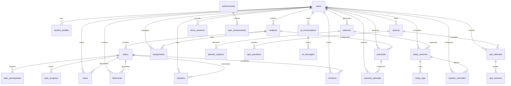

# PLANORA — Comprehensive Database Documentation

> **Version:** 2.0.0 (Master Architecture Upgrade)  
> **Supported Engines:** SQLite 3 (WAL mode) & MySQL 8.0+ (InnoDB utf8mb4)  
> **Total Registered Tables:** 30  
> **Schema Integrity:** 100% Validated (0 Foreign Key Anomalies)

---

## 1. Architecture Overview

Planora operates on a relational database layer managed via SQLAlchemy and Flask-Migrate:

* **Production / Development Default:** Persistent SQLite database stored at `backend/instance/planora.db`. Configured with `PRAGMA journal_mode=WAL` (Write-Ahead Logging) and `PRAGMA foreign_keys=ON` on every connection. This enables concurrent read access by development tools (e.g. *DB Browser for SQLite*) while the Flask application is writing.
* **Enterprise / MySQL Setup:** Fully compatible with MySQL 8.0+ through `pymysql`. Connection pool configured with `pool_recycle=280` and `pool_pre_ping=True`.
* **Database Isolation:** All student data is scoped to `user_id` with strict cascade deletes (`ON DELETE CASCADE`) to preserve referential integrity.

---

## 2. Complete Entity-Relationship (ER) Diagram



---

## 3. Detailed Table Schema Directory (30 Tables)

### Group A: Identity, Profiles & Authentication
1. **`users`**
   - `id` (INTEGER, PK): Unique student ID.
   - `name` (VARCHAR(120), NOT NULL): Full name.
   - `email` (VARCHAR(191), UNIQUE, NOT NULL): Login email.
   - `password_hash` (VARCHAR(255), NOT NULL): Bcrypt encrypted hash.
   - `xp` (INTEGER, DEFAULT 0): Total gamification experience points.
   - `streak` (INTEGER, DEFAULT 0): Consecutive daily study streak.
   - `last_active_date` (DATE): Date of last completed activity.
   - `created_at`, `updated_at` (TIMESTAMP): Audit timestamps.

2. **`student_profiles`**
   - `id` (INTEGER, PK): Unique profile record.
   - `user_id` (INTEGER, FK -> `users.id`, UNIQUE): 1:1 student link.
   - `grade_class` (VARCHAR(50)): Academic grade (e.g., *Grade 12*, *B.Tech Year 2*).
   - `board` (VARCHAR(80)): Examination board / University (e.g., *CBSE*, *State Board*, *Autonomous*).
   - `stream` (VARCHAR(80)): Academic stream (e.g., *Science PCM*, *Computer Science*, *Commerce*).
   - `daily_study_hours` (DECIMAL(3,1), DEFAULT 4.0): Target daily hours.
   - `preferred_study_time` (VARCHAR(50)): *morning*, *afternoon*, *evening*, *night*.
   - `exam_date` (DATE): Target major examination date.
   - `study_goal` (VARCHAR(255)): Motivational objective.
   - `target_score` (VARCHAR(50)): Desired score / percentage (e.g., *95%*, *GPA 9.0*).
   - `onboarding_completed` (BOOLEAN, DEFAULT FALSE).

---

### Group B: Academic Syllabus & Knowledge Graph
3. **`subjects`**
   - `id` (INTEGER, PK)
   - `user_id` (INTEGER, FK -> `users.id`, ON DELETE CASCADE)
   - `name` (VARCHAR(100), NOT NULL): e.g., *Mathematics*, *Organic Chemistry*.
   - `code` (VARCHAR(20)): Course code (e.g., *MATH-101*).
   - `color` (VARCHAR(30)): UI theme hex code (e.g., `#6366f1`).
   - `icon` (VARCHAR(50)): Lucide icon identifier (e.g., `calculator`, `atom`).
   - `target_score` (VARCHAR(50))
   - `exam_date` (DATE)

4. **`topics`**
   - `id` (INTEGER, PK)
   - `subject_id` (INTEGER, FK -> `subjects.id`, ON DELETE CASCADE)
   - `name` (VARCHAR(150), NOT NULL): Topic title.
   - `description` (TEXT): High-yield syllabus overview.
   - `chapter` (VARCHAR(100)): Parent unit or chapter name.
   - `difficulty` (VARCHAR(20), DEFAULT 'Medium'): *Easy*, *Medium*, *Hard*.
   - `estimated_minutes` (INTEGER, DEFAULT 60): Target study duration.
   - `order_index` (INTEGER, DEFAULT 1): Sequence order in syllabus.

5. **`topic_prerequisites`**
   - `id` (INTEGER, PK)
   - `topic_id` (INTEGER, FK -> `topics.id`, ON DELETE CASCADE)
   - `prerequisite_topic_id` (INTEGER, FK -> `topics.id`, ON DELETE CASCADE)
   - *Constraint:* `UNIQUE(topic_id, prerequisite_topic_id)` to prevent cyclic or redundant edges.

6. **`topic_progress`**
   - `id` (INTEGER, PK)
   - `user_id` (INTEGER, FK -> `users.id`, ON DELETE CASCADE)
   - `topic_id` (INTEGER, FK -> `topics.id`, ON DELETE CASCADE)
   - `status` (VARCHAR(30), DEFAULT 'not_started'): *not_started*, *learning*, *mastered*, *needs_revision*.
   - `confidence_level` (INTEGER, DEFAULT 1): Self-rating (1 to 5 scale).
   - `quiz_attempts_count` (INTEGER, DEFAULT 0).
   - `average_quiz_score` (DECIMAL(5,2), DEFAULT 0.0).
   - `last_studied_at` (TIMESTAMP).

---

### Group C: Study Planning, Sessions & Smart Alarms
7. **`planners`**
   - `id` (INTEGER, PK)
   - `user_id` (INTEGER, FK -> `users.id`, ON DELETE CASCADE)
   - `title` (VARCHAR(150)): Title of study sprint.
   - `start_date`, `end_date` (DATE): Planning window.
   - `daily_hours` (DECIMAL(3,1), DEFAULT 4.0): Daily study budget.
   - `status` (VARCHAR(30), DEFAULT 'active'): *active*, *completed*, *archived*.

8. **`planner_subjects`**
   - `id` (INTEGER, PK)
   - `planner_id` (INTEGER, FK -> `planners.id`, ON DELETE CASCADE)
   - `subject_id` (INTEGER, FK -> `subjects.id`, ON DELETE CASCADE)
   - `priority_weight` (INTEGER, DEFAULT 1): Relative priority (1 to 3).

9. **`study_sessions`**
   - `id` (INTEGER, PK)
   - `user_id` (INTEGER, FK -> `users.id`, ON DELETE CASCADE)
   - `planner_id` (INTEGER, FK -> `planners.id`, ON DELETE CASCADE, NULLABLE)
   - `subject_id` (INTEGER, FK -> `subjects.id`, ON DELETE CASCADE)
   - `topic_id` (INTEGER, FK -> `topics.id`, ON DELETE CASCADE)
   - `title` (VARCHAR(150), NOT NULL)
   - `scheduled_start`, `scheduled_end` (DATETIME, NOT NULL): Time window.
   - `duration_minutes` (INTEGER, DEFAULT 60)
   - `status` (VARCHAR(30), DEFAULT 'scheduled'): *scheduled*, *completed*, *missed*, *cancelled*.
   - `notes` (TEXT)

10. **`session_reminders` (Smart Alarms Engine)**
    - `id` (INTEGER, PK)
    - `user_id` (INTEGER, FK -> `users.id`, ON DELETE CASCADE)
    - `session_id` (INTEGER, FK -> `study_sessions.id`, ON DELETE CASCADE, NULLABLE)
    - `title` (VARCHAR(150), NOT NULL)
    - `subject_name`, `topic_name` (VARCHAR)
    - `scheduled_start` (DATETIME): Session start time.
    - `remind_at` (DATETIME, INDEXED): Exact timestamp to trigger audio alarm and notification.
    - `minutes_before` (INTEGER, DEFAULT 10): Configurable reminder offset (0, 5, 10, 15, 30 min).
    - `sound_enabled` (BOOLEAN, DEFAULT TRUE): Plays audio chime on trigger.
    - `status` (VARCHAR(30), DEFAULT 'pending'): *pending*, *delivered*, *dismissed*, *snoozed*.
    - `delivered_at` (DATETIME): Delivery confirmation timestamp.

11. **`study_logs`**
    - `id` (INTEGER, PK)
    - `user_id`, `session_id`, `subject_id`, `topic_id` (Foreign Keys)
    - `actual_minutes` (INTEGER): Recorded study duration.
    - `focus_rating` (INTEGER, 1-5): Student self-assessment of focus.
    - `topics_covered` (TEXT): Freeform reflection.
    - `completed_at` (TIMESTAMP).

12. **`focus_sessions`**
    - `id` (INTEGER, PK)
    - `user_id`, `subject_id`, `topic_id` (Foreign Keys)
    - `duration_minutes` (INTEGER): Configured block.
    - `actual_minutes` (INTEGER): Actual elapsed time before finish.
    - `breaks_count` (INTEGER, DEFAULT 0).
    - `completed` (BOOLEAN, DEFAULT TRUE).

---

### Group D: Active Recall, Revisions & Mistakes
13. **`flashcards`**
    - `id` (INTEGER, PK)
    - `user_id`, `subject_id`, `topic_id` (Foreign Keys)
    - `front_text` (TEXT, NOT NULL): Prompt / Question.
    - `back_text` (TEXT, NOT NULL): Answer / Formula explanation.
    - `difficulty` (VARCHAR(20), DEFAULT 'Medium'): *Easy*, *Medium*, *Hard*.
    - `mastery_level` (VARCHAR(20), DEFAULT 'new'): *new*, *need_revision*, *known*.
    - `last_reviewed_at` (TIMESTAMP).

14. **`revisions`**
    - `id` (INTEGER, PK)
    - `user_id`, `topic_id` (Foreign Keys)
    - `interval_day` (INTEGER): Ebbinghaus spacing interval (1, 3, 7, 14, 30 days).
    - `scheduled_date` (DATE, INDEXED): Date revision is due.
    - `status` (VARCHAR(30), DEFAULT 'pending'): *pending*, *completed*, *overdue*.
    - `performance_score` (DECIMAL(5,2)): 0 to 100 rating.
    - `completed_at` (TIMESTAMP).

15. **`mistakes` (Error Notebook)**
    - `id` (INTEGER, PK)
    - `user_id`, `subject_id`, `topic_id` (Foreign Keys)
    - `question_text` (TEXT, NOT NULL): The problem text.
    - `student_answer` (TEXT): What the student chose/wrote.
    - `correct_answer` (TEXT): The verified correct response.
    - `explanation` (TEXT): Conceptual breakdown and error avoidance tip.
    - `recurrence_count` (INTEGER, DEFAULT 1): Number of times student repeated error.
    - `is_resolved` (BOOLEAN, DEFAULT FALSE): Marked resolved when re-tested successfully.

---

### Group E: Diagnostic Quizzes & Evaluations
16. **`quizzes`**
    - `id` (INTEGER, PK)
    - `user_id`, `subject_id`, `topic_id` (Foreign Keys)
    - `title` (VARCHAR(150), NOT NULL)
    - `difficulty` (VARCHAR(20), DEFAULT 'Medium')
    - `total_questions` (INTEGER, DEFAULT 5)

17. **`quiz_questions`**
    - `id` (INTEGER, PK)
    - `quiz_id` (INTEGER, FK -> `quizzes.id`, ON DELETE CASCADE)
    - `question_text` (TEXT, NOT NULL)
    - `option_a`, `option_b`, `option_c`, `option_d` (TEXT, NOT NULL)
    - `correct_option` (VARCHAR(10), NOT NULL): *A*, *B*, *C*, or *D*.
    - `explanation` (TEXT, NOT NULL): Detailed solution.
    - `points` (INTEGER, DEFAULT 1)

18. **`quiz_attempts`**
    - `id` (INTEGER, PK)
    - `user_id`, `quiz_id` (Foreign Keys)
    - `score` (INTEGER): Correct answers count.
    - `total_questions` (INTEGER)
    - `percentage` (DECIMAL(5,2))
    - `time_taken_seconds` (INTEGER)
    - `completed_at` (TIMESTAMP)

19. **`quiz_answers`**
    - `id` (INTEGER, PK)
    - `attempt_id` (INTEGER, FK -> `quiz_attempts.id`, ON DELETE CASCADE)
    - `question_id` (INTEGER, FK -> `quiz_questions.id`, ON DELETE CASCADE)
    - `selected_option` (VARCHAR(10), NOT NULL)
    - `is_correct` (BOOLEAN, NOT NULL)

---

### Group F: Universal Practical Lab
20. **`practicals`**
    - `id` (INTEGER, PK)
    - `user_id` (INTEGER, FK -> `users.id`, ON DELETE CASCADE)
    - `subject_id` (INTEGER, FK -> `subjects.id`, ON DELETE SET NULL, NULLABLE)
    - `title` (VARCHAR(200), NOT NULL)
    - `field_category` (VARCHAR(50), NOT NULL, INDEXED): *science*, *computer_science*, *engineering*, *commerce*, *humanities*, *vocational*.
    - `academic_level` (VARCHAR(50), DEFAULT 'Undergraduate')
    - `aim` (TEXT, NOT NULL): Stated objective.
    - `apparatus_or_tools` (TEXT): Apparatus, components, or software required.
    - `theory_concepts` (TEXT): Principles and governing formulas.
    - `procedure_steps` (TEXT): Structured JSON array of procedural steps.
    - `observations_schema` (TEXT): Structured JSON columns for observations table.
    - `calculations_formula` (TEXT): Step-by-step reduction formula / algorithm complexity.
    - `safety_guidelines` (TEXT): Lab safety protocol and error prevention.
    - `viva_questions_json` (TEXT): JSON array of oral test Q&As.
    - `is_custom` (BOOLEAN, DEFAULT FALSE)

21. **`practical_attempts`**
    - `id` (INTEGER, PK)
    - `user_id`, `practical_id` (Foreign Keys)
    - `observations_data` (TEXT): Recorded student readings.
    - `calculations_data` (TEXT): Computed outcomes.
    - `student_notes_or_code` (TEXT): Code snippets, analysis notes, or observations.
    - `viva_score` (DECIMAL(5,2), DEFAULT 0.0): Viva test score.
    - `readiness_percentage` (DECIMAL(5,2), DEFAULT 0.0): Readiness score (0-100%).
    - `feedback` (TEXT): AI examiner qualitative feedback.
    - `status` (VARCHAR(30), DEFAULT 'completed')
    - `completed_at` (TIMESTAMP)

---

### Group G: Assignments & Deadline Management
22. **`assignments`**
    - `id` (INTEGER, PK)
    - `user_id` (INTEGER, FK -> `users.id`, ON DELETE CASCADE)
    - `subject_id` (INTEGER, FK -> `subjects.id`, ON DELETE SET NULL)
    - `title` (VARCHAR(200), NOT NULL)
    - `description` (TEXT)
    - `due_date` (DATE, NOT NULL, INDEXED)
    - `priority` (VARCHAR(20), DEFAULT 'Medium'): *High*, *Medium*, *Low*.
    - `status` (VARCHAR(30), DEFAULT 'pending'): *pending*, *in_progress*, *completed*.
    - `progress_percentage` (INTEGER, DEFAULT 0)

---

### Group H: AI Tutor, Memory & Documents
23. **`notes`**
    - `id` (INTEGER, PK)
    - `user_id`, `subject_id`, `topic_id` (Foreign Keys)
    - `title`, `summary`, `key_points`, `formulas`, `examples`, `exam_tips`, `raw_content` (TEXT)

24. **`ai_conversations`**
    - `id` (INTEGER, PK)
    - `user_id`, `topic_id` (Foreign Keys)
    - `title` (VARCHAR(150)), `mode` (VARCHAR(50), DEFAULT 'tutor')

25. **`ai_messages`**
    - `id` (INTEGER, PK)
    - `conversation_id` (INTEGER, FK -> `ai_conversations.id`, ON DELETE CASCADE)
    - `role` (VARCHAR(20)): *user* or *assistant*.
    - `content` (TEXT, NOT NULL)
    - `image_url` (VARCHAR(255), NULLABLE)

26. **`study_memories`**
    - `id` (INTEGER, PK)
    - `user_id`, `subject_id`, `topic_id` (Foreign Keys, UNIQUE constraint)
    - `chapter`, `last_position`, `last_activity` (VARCHAR)

27. **`uploaded_documents`**
    - `id` (INTEGER, PK)
    - `user_id` (INTEGER, FK -> `users.id`)
    - `filename`, `original_name`, `file_size`, `file_type`, `file_path`, `extracted_text_summary`

---

### Group I: Gamification & Notifications
28. **`achievements`**
    - `id` (INTEGER, PK), `code` (VARCHAR(50), UNIQUE), `title`, `description`, `icon`, `badge_name`, `xp_reward`

29. **`user_achievements`**
    - `id` (INTEGER, PK)
    - `user_id` (FK -> `users.id`), `achievement_id` (FK -> `achievements.id`), `unlocked_at`

30. **`notifications`**
    - `id` (INTEGER, PK), `user_id` (FK -> `users.id`)
    - `type`, `title`, `message`, `link`, `is_read` (BOOLEAN, INDEXED)

---

## 4. Feature-to-Table Mapping Matrix

| Planora Screen / Feature | Route | Database Tables Utilized |
| :--- | :--- | :--- |
| **Student Dashboard** | `/dashboard` | `users`, `student_profiles`, `study_sessions`, `session_reminders`, `revisions`, `achievements` |
| **Smart Study Planner** | `/planner` | `planners`, `planner_subjects`, `study_sessions`, `topics`, `subjects` |
| **Study Hub (7 Learning Tabs)** | `/study-hub/:id` | `topics`, `subjects`, `notes`, `flashcards`, `mistakes`, `quizzes`, `study_memories` |
| **Interactive 3D Universe** | `/universe` | `subjects`, `topics`, `topic_prerequisites`, `topic_progress` |
| **Smart Alarms & Reminders** | `/alarms` | `session_reminders`, `study_sessions`, `subjects`, `topics` |
| **Universal Practical Lab** | `/practicals` | `practicals`, `practical_attempts`, `subjects` |
| **Assignments & Deadlines** | `/assignments` | `assignments`, `subjects` |
| **Database Explorer** | `/admin/database` | Direct introspection of all 30 database tables with pagination and search |
| **AI Personal Tutor** | `/ai-tutor` | `ai_conversations`, `ai_messages`, `topics` |
| **AI Doubt Solver** | `/doubt-solver` | `ai_conversations`, `ai_messages` |
| **Smart Spaced Repetition** | `/revisions` | `revisions`, `topics`, `subjects` |
| **Mistake Notebook** | `/mistakes` | `mistakes`, `topics`, `subjects` |
| **Active Recall Flashcards** | `/flashcards` | `flashcards`, `topics`, `subjects` |
| **Adaptive Quizzes** | `/quizzes` | `quizzes`, `quiz_questions`, `quiz_attempts`, `quiz_answers`, `mistakes` |
| **Deep Focus Timer** | `/focus` | `focus_sessions`, `study_logs`, `users` (XP boost) |
| **Progress & Analytics** | `/analytics` | `study_logs`, `topic_progress`, `quiz_attempts`, `revisions`, `mistakes` |

---

## 5. Maintenance, Backup & Integrity Guide

### Run Database Diagnostics
```bash
# View live table counts and row statistics
python backend/analyze_db.py

# Quick statistics
python backend/backup_db.py stats
```

### Create a Consistent Timestamped Backup
```bash
python backend/backup_db.py backup
```

### Export All Tables to SQL Dump
```bash
python backend/backup_db.py export_sql
```

### Open Directly in DB Browser for SQLite
Double-click `open_in_db_browser.bat` in the project root. It will immediately open `backend/instance/planora.db` in DB Browser for SQLite.
