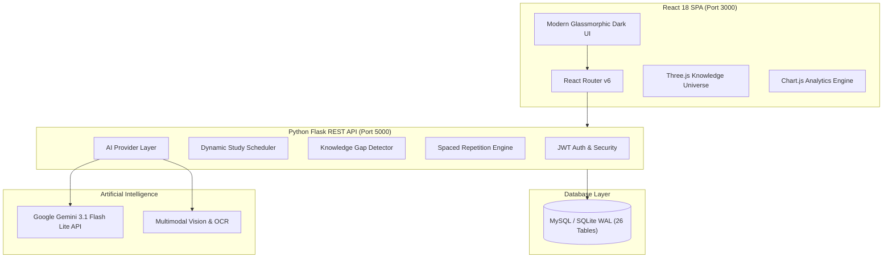
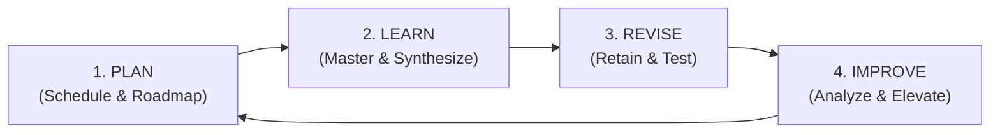
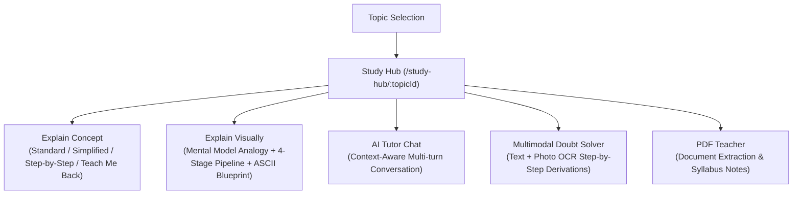
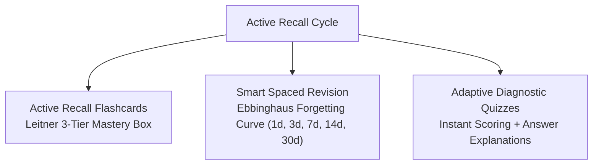
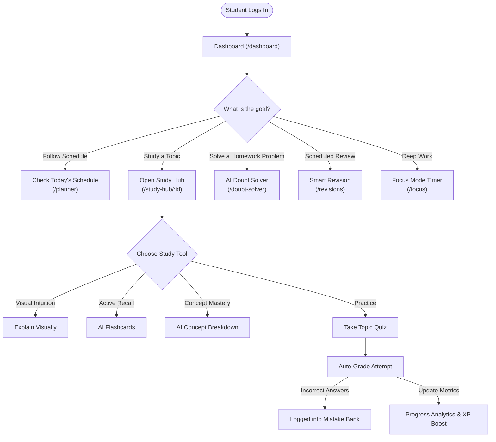

# PLANORA — Full Feature Architecture & System Map

> **Tagline:** *Plan. Learn. Revise. Improve.*  
> **Platform:** Modern AI-Powered Study Planner & Adaptive Learning Coach  
> **Stack:** React 18, Vite, Three.js, Chart.js, Lucide Icons, Python Flask REST API, MySQL / SQLite (WAL), Google Gemini AI

---

## 1. High-Level Architectural Flow

---

## 2. The 4 Core Pillars: Feature Matrix

Planora is structured around four interconnected learning phases:

---

### Pillar 1: PLAN (Smart Scheduling & Roadmaps)

| Feature Module | Screen Route | Capabilities & What It Does |
| :--- | :--- | :--- |
| **Smart Study Planner** | `/planner` | Generates adaptive multi-week study timetables taking into account target exam dates, daily available hours, topic difficulty ratings, and prerequisite order. |
| **Daily Calendar & Session Queue** | `/planner`, `/dashboard` | Organizes study blocks into morning, afternoon, evening, and night slots with progress checkboxes and reschedule controls. |
| **Prerequisite Learning Graph** | `/universe` | Visual dependency network ensuring foundation topics (e.g., *Limits*) are studied before advanced dependents (e.g., *Integration*). |
| **Student Onboarding Wizard** | `/onboarding` | Calibrates student baseline: Grade level, academic board, study stream (PCM/PCB/Commerce), target score %, and daily commitment. |

---

### Pillar 2: LEARN (AI Conceptual Mastery)

| Feature Module | Screen Route | Capabilities & What It Does |
| :--- | :--- | :--- |
| **Study Hub** | `/study-hub/:id` | Central command cockpit for any topic containing all learning modes, formulas, mistakes, notes, and video masterclasses in one tabbed view. |
| **Multi-Style Concept Explainer** | `/study-hub` | 4 distinct Gemini AI explanation styles: **Standard** (rigorous), **Simplified** (ELIF/intuitive), **Step-by-Step** (derivation), and **Teach Me Back** (Feynman method). |
| **AI Visual Concept Designer** | `/study-hub` | Generates real-world mental model analogies, 4-stage mathematical transformation stages with formula badges, ASCII flowcharts, and governing equations. |
| **24/7 AI Personal Tutor** | `/ai-tutor` | Chat interface with contextual memory across subjects. Retains conversation history and provides structured markdown responses with clean math formatting. |
| **Multimodal Doubt Solver** | `/doubt-solver` | Resolves complex homework doubts via question text or image uploads (OCR diagram reading) with step-by-step breakdown, key concepts, and common trap warnings. |
| **Interactive 3D Knowledge Universe** | `/universe` | 3D visual starfield map using Three.js displaying subject solar systems and topic nodes colored dynamically by mastery level (green = mastered, amber = learning, gray = not started). |
| **PDF Teacher & Document Reader** | `/pdf-teacher` | Upload textbooks, lecture slides, or exam notes (PDF/images) to automatically extract core concepts, definitions, and auto-generate summary notes. |

---

### Pillar 3: REVISE (Active Recall & Spaced Repetition)

| Feature Module | Screen Route | Capabilities & What It Does |
| :--- | :--- | :--- |
| **Active Recall Flashcards** | `/flashcards`, `/study-hub` | 3D flip cards with question on front and answer on back. Includes a **+ Generate 5 AI Flashcards** button to synthesize topic-specific revision decks on demand. |
| **Spaced Repetition Engine** | `/revisions` | Automatic scheduling based on the Ebbinghaus forgetting curve with predefined review intervals (Day 1, Day 3, Day 7, Day 14, Day 30). |
| **Adaptive Diagnostic Quizzes** | `/quizzes` | Generates multiple-choice question sets with difficulty grading, instant score calculation, percentage evaluation, and comprehensive explanations. |
| **Mistake Auto-Capture** | `/quizzes`, `/mistakes` | Any question answered incorrectly during a quiz is automatically sent to the Mistake Bank with student choice and correct answer recorded. |

---

### Pillar 4: IMPROVE (Analytics & Error Eradication)

| Feature Module | Screen Route | Capabilities & What It Does |
| :--- | :--- | :--- |
| **Mistake Bank (Error Notebook)** | `/mistakes` | Central repository of all student mistakes. Categorized by root cause: **Calculation Error**, **Conceptual Gap**, or **Question Misread**, with resolution tracking. |
| **Knowledge Gap Detector** | `/analytics` | Algorithmic audit identifying weak topics with low quiz scores or repeated mistakes, flagging them for prioritized revision. |
| **Progress & Performance Analytics** | `/analytics` | Chart.js interactive graphs: Daily study hours distribution, subject completion %, topic confidence heatmaps, and exam readiness scores. |
| **Deep Focus Mode (Pomodoro)** | `/focus` | Built-in study timer (25m / 45m / 60m focus blocks) with ambient background audio, streak counter, full-screen distraction shielding, and study log recording. |
| **Gamification, Streaks & XP** | Everywhere | Experience points (XP) awarded for completing sessions, quizzes, and revisions. Dynamic streak counter and unlockable achievement badges. |

---

## 3. End-to-End User Experience Map

---

## 4. Technical Feature Summary Table

| Category | Count | Key Technologies & Implementations |
| :--- | :---: | :--- |
| **Total Web Screens** | **16** | React Router v6, Tailwind/CSS3 Glassmorphic Theme |
| **Database Tables** | **26** | MySQL 8.0 & SQLite WAL mode (`planora.db`) |
| **AI Capabilities** | **7** | Concept Explainer, Visual Blueprint, Flashcard Generator, Quiz Engine, Multimodal Doubt Solver, Tutor Chat, PDF Teacher |
| **Visual Engagements** | **4** | Three.js Knowledge Universe, Chart.js Analytics, 3D Flip Cards, ASCII Blueprints |
| **Memory Systems** | **3** | Leitner Flashcard Boxes, Spaced Repetition Intervals, Persistent Mistake Bank |
